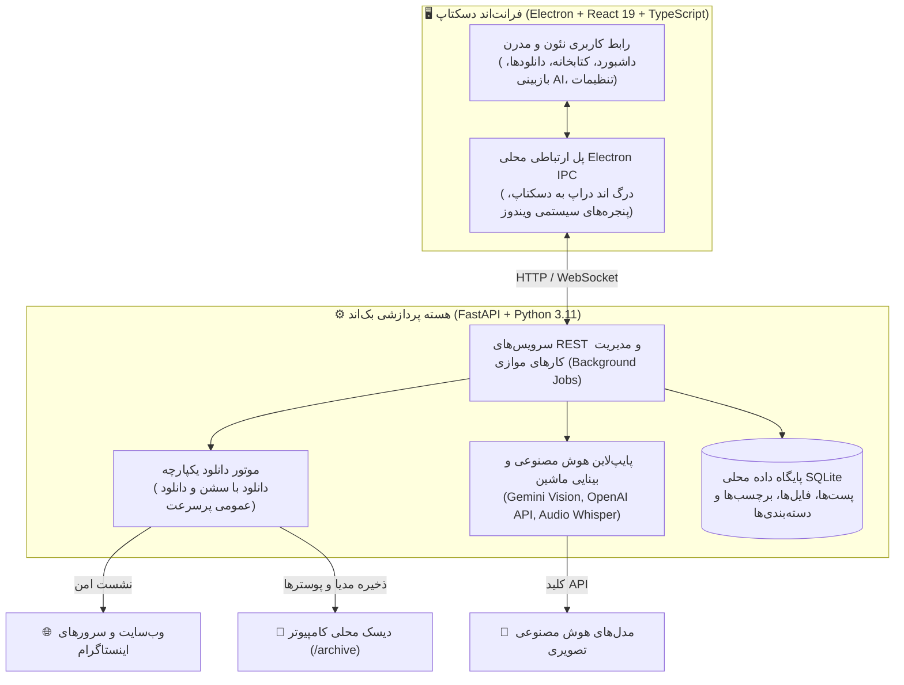

<div align="center">

# 📸 استودیوی آرشیو و هوش مصنوعی اینستاگرام

### *سیستم حرفه‌ای، کاملاً آفلاین و محلی برای ذخیره‌سازی، دانلود پیوسته و تحلیل رسانه‌های اینستاگرام با هوش مصنوعی*

<p align="center">
  <a href="README.md"><b>English (انگلیسی)</b></a> &nbsp;•&nbsp;
  <b>فارسی</b>
</p>

[](https://github.com)
[](https://opensource.org/licenses/MIT)
[](https://www.typescriptlang.org/)
[](https://react.dev/)
[](https://www.electronjs.org/)
[](https://fastapi.tiangolo.com/)
[](https://www.python.org/)

<p align="center">
  یک نرم‌افزار دسکتاپ مدرن و قدرتمند که به‌صورت اختصاصی برای حفظ دائمی، سازمان‌دهی و هوشمندسازی ذخیره‌ها (Saved) و لایک‌های (Liked) اینستاگرام شما همراه با بینایی ماشین، استخراج متن صوت ویدیوها و Drag & Drop بومی به ویندوز طراحی شده است.
</p>

</div>

---

<div dir="rtl">

## 🌟 ویژگی‌های برجسته

- **🔒 ۱۰۰٪ محلی و امن (Local-First):** کلیه تصاویر، ویدیوها، کپشن‌ها و پایگاه داده به‌صورت اختصاصی تنها روی دیسک کامپیوتر شما ذخیره می‌شوند و هیچ اطلاعاتی در سرور ثالثی قرار نمی‌گیرد.
- **🛡️ اتصال بدون ریسک و بدون پسورد:** ورود امن از طریق مرورگر رسمی داخل اپلیکیشن یا کوکی مرورگر (`sessionid`). رمز عبور اکانت شما هرگز دریافت یا ذخیره نمی‌شود.
- **⚡ دانلود پیوسته و هوشمند (Continuous Pipeline):** امکان دریافت آرشیوهای بزرگ چند هزارتایی بدون توقف، همراه با مدیریت خطای خودکار و کنترل محدودیت‌های ساعتی اینستاگرام.
- **🧠 بینایی ماشین و هوش مصنوعی چندوجهی:** دسته‌بندی موضوعی، استخراج کلیدواژه‌ها و خلاصه‌سازی کپشن و محتوای بصری تصاویر و فریم‌های ویدیو با Gemini Vision یا مدل‌های سازگار با OpenAI.
- **🎙️ استخراج صوت و رونوشت گفتار ویدیوها:** تبدیل گفتار داخل ریلزها و ویدیوها به متن قابل جستجو در کتابخانه.
- **📁 قابلیت Drag & Drop به دسکتاپ ویندوز:** امکان کشیدن فایل رسانه‌ها با ماوس مستقیماً از داخل نرم‌افزار و رها کردن آن‌ها روی دسکتاپ یا پوشه‌های ویندوز.
- **🌐 رابط کاربری کاملاً دوزبانه و تفکیک‌شده:** پشتیبانی طبیعی و روان از هر دو زبان فارسی (راست‌چین) و انگلیسی (چپ‌چین) بدون هرگونه تداخل یا ترکیب زبان‌ها.
- **🧹 تشخیص و حذف فایل‌های تکراری:** مقایسه هش SHA-256 و اطمینان از سلامت فایل‌های محلی بدون اشغال فضای هارد اضافه.

---

## 🏗️ ساختار و معماری سیستم



---

## 🚀 راهنمای سریع راه‌اندازی

### پیش‌نیازها
- **پایتون:** نسخه `3.10` به بالا (پیشنهادی: `3.11`)
- **نود جی‌اس:** نسخه `18.0.0` به بالا (پیشنهادی: `v20` LTS)
- **گیت (Git)**

---

### گام اول: دریافت مخزن (Clone)
```bash
git clone https://github.com/heat-core/instagram-vault.git
cd instagram-vault
```

---

### گام دوم: راه‌اندازی بخش بک‌اند (پایتون)
```bash
# ۱. ایجاد محیط مجازی (Virtual Environment)
python -m venv venv

# ۲. فعال‌سازی محیط مجازی
# در ویندوز:
.\venv\Scripts\activate
# در مک یا لینوکس:
source venv/bin/activate

# ۳. نصب کتابخانه‌های مورد نیاز
pip install -r requirements.txt

# ۴. اجرای سرور بک‌اند
python backend_entry.py
```
> سرور بک‌اند روی آدرس `http://127.0.0.1:8000` راه‌اندازی می‌شود و مستندات اینتراکتیو API در آدرس `http://127.0.0.1:8000/docs` در دسترس خواهد بود.

---

### گام سوم: راه‌اندازی فرانت‌اند دسکتاپ
در یک ترمینال جداگانه:
```bash
cd desktop

# ۱. نصب پکیج‌های فرانت‌اند
npm install

# ۲. اجرای برنامه در حالت توسعه (Dev Mode)
npm run dev
```

---

## 📦 ساخت فایل اجرایی مستقل ویندوز (.exe)

شما می‌توانید با یک دستور ساده فایل‌های اجرایی نهایی ویندوز (`Saved Archive.exe` و `archive-api.exe`) را تولید کنید:

```powershell
# اجرای اسکریپت خودکار بیلد و پکیجینگ:
.\build-windows.ps1
```
برنامه نهایی و بدون نیاز به نصب در مسیر `desktop/release/win-unpacked/Saved Archive.exe` ایجاد می‌شود.

---

## 🎮 کلیدهای میانبر پخش‌کننده رسانه (Inspector)

هنگام تماشای ویدیوها در پنجره مشخصات، کلیدهای میانبر زیر فعال هستند:

| کلید میانبر | عملکرد |
| :--- | :--- |
| <kbd>Space</kbd> | توقف / پخش ویدیو |
| <kbd>←</kbd> | ۵ ثانیه به عقب |
| <kbd>→</kbd> | ۵ ثانیه به جلو |
| <kbd>↑</kbd> / <kbd>↓</kbd> | افزایش / کاهش صدا |
| <kbd>M</kbd> | قطع / وصل صدا (Mute) |
| <kbd>F</kbd> | نمایش تمام صفحه |
| <kbd>Esc</kbd> | بستن پنجره جزئیات |

---

## 🛡️ تعهدات حریم خصوصی و امنیت

1. **بدون نیاز به پسورد:** شما هیچ‌گاه رمز عبور اینستاگرام خود را در این برنامه وارد نمی‌کنید.
2. **رمزگذاری نشست‌ها:** تمامی کوکی‌ها و توکن‌های نشست به‌صورت رمزگذاری‌شده در سیستم محلی شما نگهداری می‌شوند.
3. **بدون ردیابی یا ارسال اطلاعات:** این برنامه هیچ‌گونه داده، رفتار یا تحلیلی از شما را به سرورهای ناشناس ارسال نمی‌کند و ارتباط فقط میان کامپیوتر شما، اینستاگرام و ارائه‌دهنده انتخابی هوش مصنوعی شماست.

---

## 📄 مجوز انتشار (License)

این پروژه تحت مجوز متن‌باز **MIT License** منتشر شده است. برای مشاهده جزئیات به فایل [LICENSE](LICENSE) مراجعه کنید.

</div>

---

<div align="center">
  <sub>ساخته‌شده با ❤️ برای حفظ همیشگی خاطرات دیجیتال و محتواهای ارزشمند شخصی.</sub>
</div>
