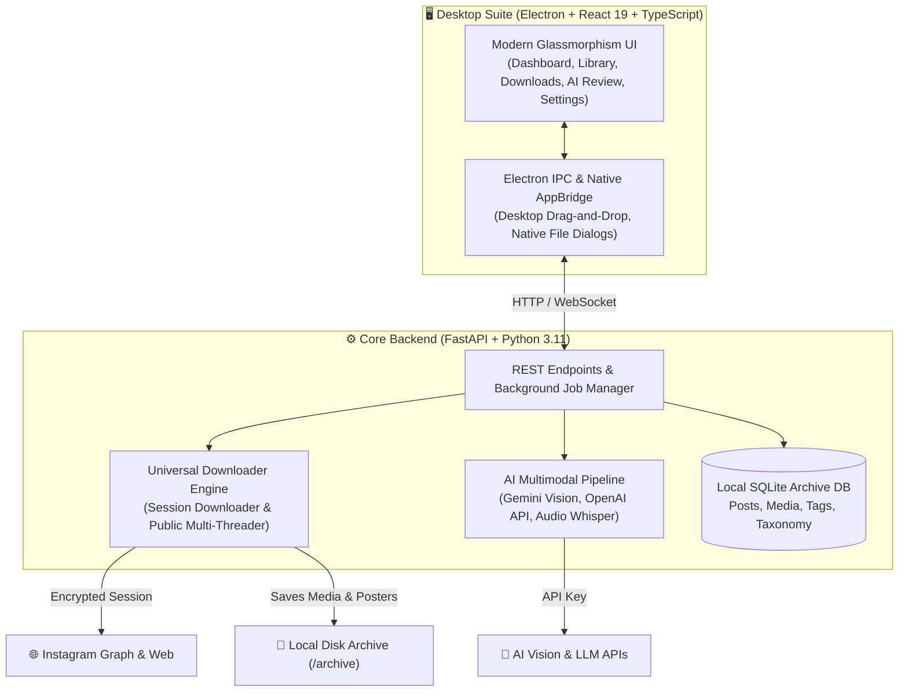

<div align="center">

# 📸 Instagram Vault & AI Studio

### *Enterprise-Grade, Local-First Instagram Media Archiving, Continuous Downloader & Multimodal AI Studio*

<p align="center">
  <b>English</b> &nbsp;•&nbsp;
  <a href="README.fa.md"><b>فارسی (Persian)</b></a>
</p>

[](https://github.com)
[](https://opensource.org/licenses/MIT)
[](https://www.typescriptlang.org/)
[](https://react.dev/)
[](https://www.electronjs.org/)
[](https://fastapi.tiangolo.com/)
[](https://www.python.org/)

<p align="center">
  A state-of-the-art desktop suite engineered to permanently preserve, organize, and enrich your Instagram Saved & Liked collections with local AI vision, audio speech transcription, and native Windows desktop drag-and-drop.
</p>

</div>

---

## 🌟 Key Highlights

- **🔒 100% Local-First & Private:** All downloaded photos, videos, captions, and databases remain strictly on your personal machine.
- **🛡️ Zero-Risk Instagram Authentication:** Built-in official in-app browser window or cookie login (`sessionid`). No account passwords are ever stored or exposed.
- **⚡ Continuous Auto-Download Pipeline:** Download entire archives of thousands of posts without interruptions, with automatic retry and rate-limit backoff.
- **🧠 Multimodal AI Vision & Taxonomy:** Automatically categorize, tag, and summarize photos and video clips using Gemini Vision or OpenAI-compatible models.
- **🎙️ Video Speech & Audio Transcription:** Transcribes spoken audio in Reels and videos into searchable text.
- **📁 Native Windows Desktop Drag-and-Drop:** Drag media items directly from the app window onto your Windows desktop or physical folders.
- **🌐 Complete Bilingual UI:** Independent, fully isolated Persian (RTL) and English (LTR) language support with zero cross-language bleeding.
- **🧹 Deduplication & Integrity Scanner:** SHA-256 media hashing and database verification prevents redundant downloads and detects missing files.

---

## 🏗️ System Architecture



---

## 🚀 Quick Start Guide

### Prerequisites
- **Python:** `3.10` or higher (Python `3.11` recommended)
- **Node.js:** `v18.0.0` or higher (Node `v20` LTS recommended)
- **Git**

---

### Step 1: Clone Repository
```bash
git clone https://github.com/heat-core/instagram-vault.git
cd instagram-vault
```

---

### Step 2: Set Up Backend (Python)
```bash
# 1. Create a virtual environment
python -m venv venv

# 2. Activate virtual environment
# Windows:
.\venv\Scripts\activate
# macOS/Linux:
source venv/bin/activate

# 3. Install dependencies
pip install -r requirements.txt

# 4. Launch backend server
python backend_entry.py
```
> The backend server will start on `http://127.0.0.1:8000`. You can visit `http://127.0.0.1:8000/docs` to inspect the Swagger API interactive documentation.

---

### Step 3: Set Up & Launch Frontend (Desktop)
In a new terminal window:
```bash
cd desktop

# 1. Install frontend dependencies
npm install

# 2. Start Electron & React Vite in development mode
npm run dev
```

---

## 📦 Building Standalone Windows Executable (.exe)

You can build a production-ready, self-contained Windows executable package (`Saved Archive.exe` and `archive-api.exe`) with a single command:

```powershell
# Run the included automated build script:
.\build-windows.ps1
```
The compiled, ready-to-run application will be generated in `desktop/release/win-unpacked/Saved Archive.exe`.

---

## 🎮 Keyboard Shortcuts (Media Inspector)

When previewing media or playing videos in the Inspector Drawer, the following shortcuts are supported:

| Shortcut | Action |
| :--- | :--- |
| <kbd>Space</kbd> | Toggle Play / Pause video |
| <kbd>←</kbd> | Rewind 5 seconds |
| <kbd>→</kbd> | Fast-forward 5 seconds |
| <kbd>↑</kbd> / <kbd>↓</kbd> | Volume up / down |
| <kbd>M</kbd> | Toggle Mute / Unmute |
| <kbd>F</kbd> | Open Fullscreen Zoom |
| <kbd>Esc</kbd> | Close Zoom or Inspector |

---

## 🛡️ Privacy & Security Commitments

1. **Passwordless Authentication:** You never need to enter your Instagram password into this application.
2. **Local Session Encryption:** All authentication cookies are stored in encrypted format locally on your machine.
3. **No Tracking / No Telemetry:** This application does not track your activity, send analytics, or contact any third-party servers except Instagram and your chosen AI provider.

---

## 🤝 Contributing

Contributions, issues, and feature requests are welcome! Feel free to check the [issues page](https://github.com) or read our [Contribution Guidelines](CONTRIBUTING.md).

---

## 📄 License

This project is licensed under the **MIT License** - see the [LICENSE](LICENSE) file for details.

---

<div align="center">
  <sub>Made with ❤️ for preserving cultural digital memories and personal creative inspiration.</sub>
</div>
